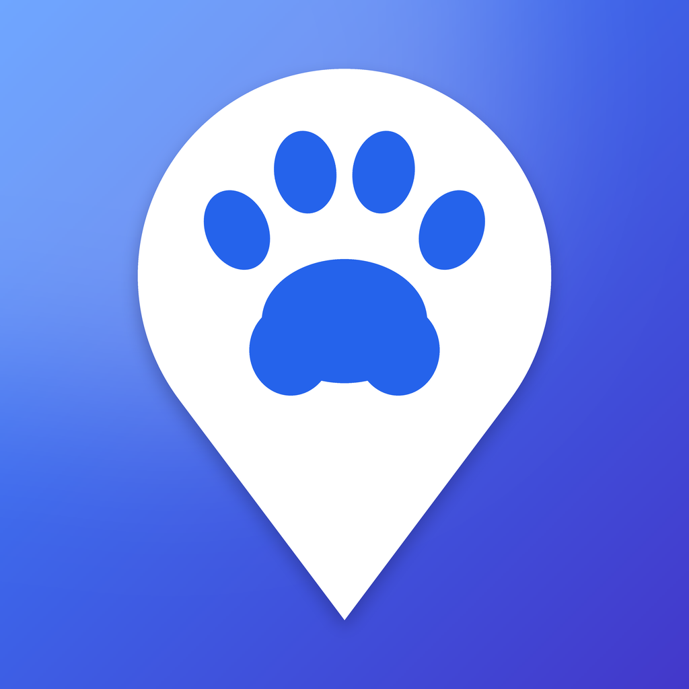
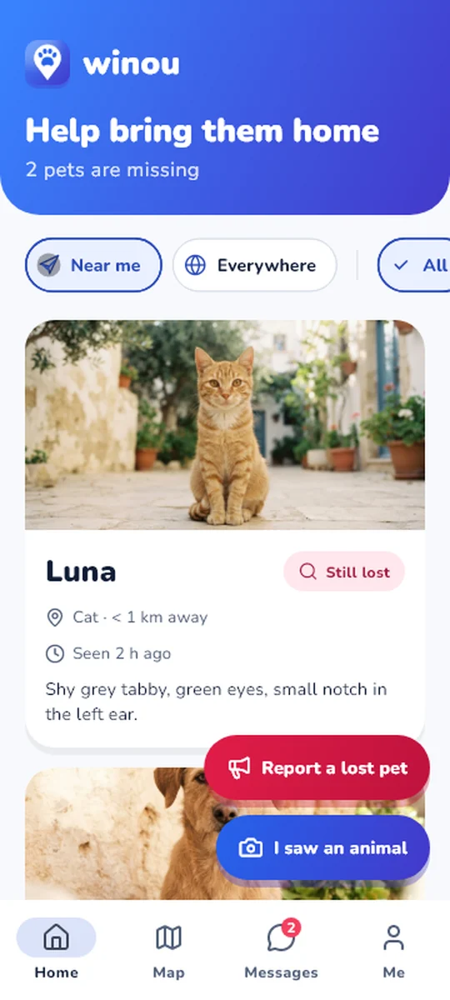
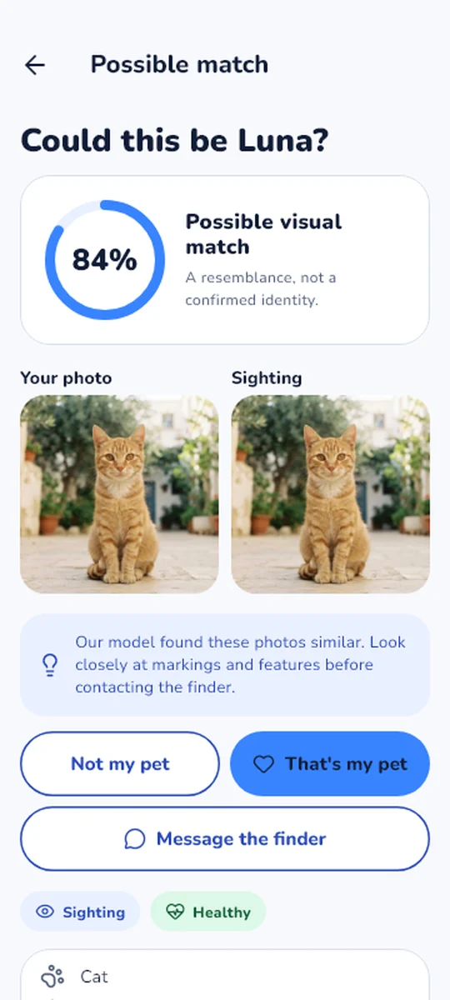
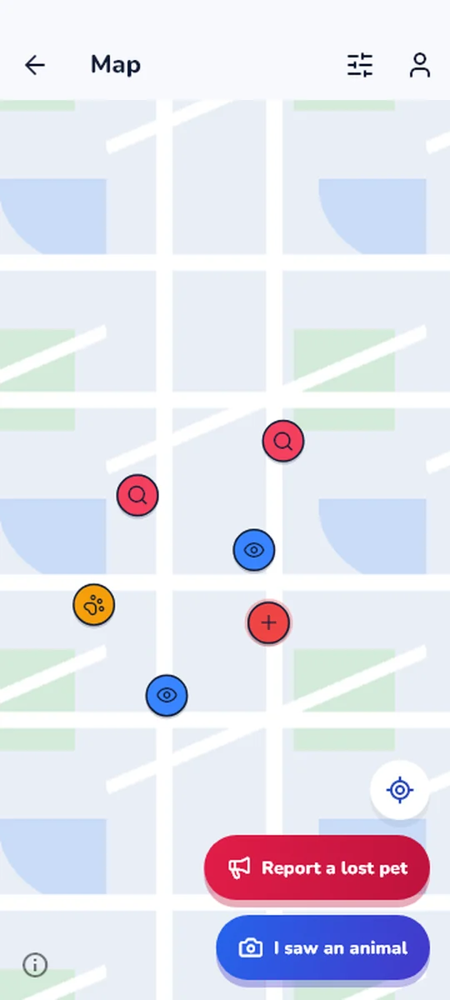
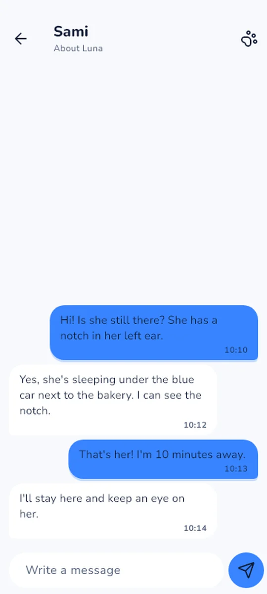
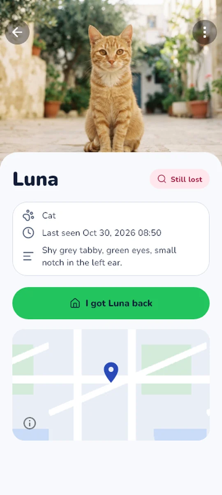
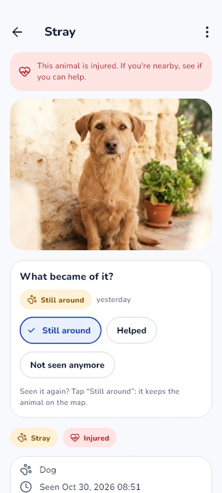
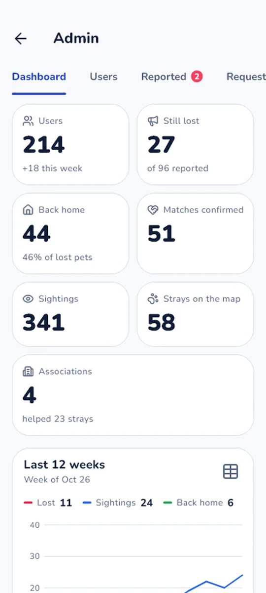
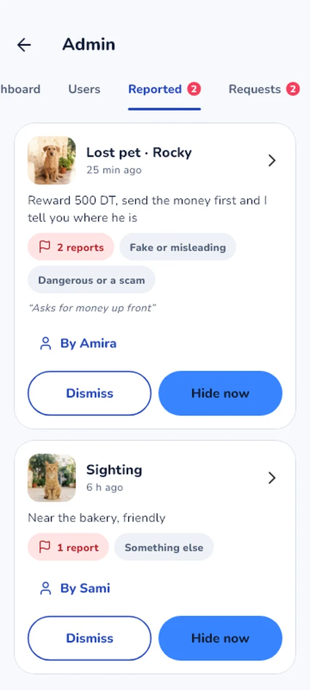
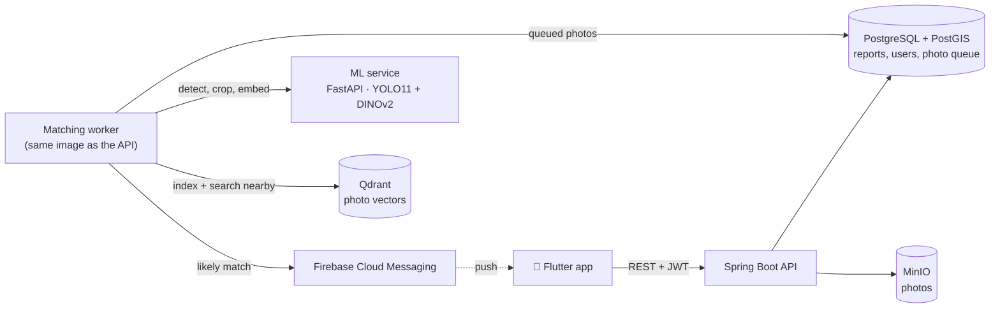

<div align="center">



# Winou

**Find lost pets, help street animals.**

A mobile app that matches photos of loose animals against nearby lost-pet reports
with image embeddings, plus a community map of street animals. Built for Tunis.


[Features](#features) · [How it works](#how-it-works) · [Does matching work?](#does-matching-work) ·
[Run it](#run-it) · [Reference](#reference)

</div>

<table align="center">
  <tr>
    <td align="center" width="25%">
      <picture>
        <source media="(prefers-color-scheme: dark)" srcset="docs/screenshots/home-dark.webp">
        
      </picture>
      <br><sub><b>Missing pets nearby</b></sub>
    </td>
    <td align="center" width="25%">
      <picture>
        <source media="(prefers-color-scheme: dark)" srcset="docs/screenshots/match-dark.webp">
        
      </picture>
      <br><sub><b>A possible match</b></sub>
    </td>
    <td align="center" width="25%">
      <picture>
        <source media="(prefers-color-scheme: dark)" srcset="docs/screenshots/map-dark.webp">
        
      </picture>
      <br><sub><b>Lost, seen and stray on one map</b></sub>
    </td>
    <td align="center" width="25%">
      <picture>
        <source media="(prefers-color-scheme: dark)" srcset="docs/screenshots/chat-dark.webp">
        
      </picture>
      <br><sub><b>Owner and finder talk</b></sub>
    </td>
  </tr>
  <tr>
    <td align="center">
      <picture>
        <source media="(prefers-color-scheme: dark)" srcset="docs/screenshots/lost-pet-dark.webp">
        
      </picture>
      <br><sub><b>A lost pet's page</b></sub>
    </td>
    <td align="center">
      <picture>
        <source media="(prefers-color-scheme: dark)" srcset="docs/screenshots/stray-dark.webp">
        
      </picture>
      <br><sub><b>A stray: what became of it?</b></sub>
    </td>
    <td align="center">
      <picture>
        <source media="(prefers-color-scheme: dark)" srcset="docs/screenshots/admin-dashboard-dark.webp">
        
      </picture>
      <br><sub><b>Admin dashboard</b></sub>
    </td>
    <td align="center">
      <picture>
        <source media="(prefers-color-scheme: dark)" srcset="docs/screenshots/admin-reported-dark.webp">
        
      </picture>
      <br><sub><b>Moderation</b></sub>
    </td>
  </tr>
</table>

<p align="center"><sub>Screens rendered with sample data by the app's screenshot harness; light or dark follows your GitHub theme.</sub></p>

## Features

**Lost pets.** Report your pet with a few photos and where it was last seen. Its position is shown
only approximately to others, never your home.

**"I saw an animal."** Anyone can post a loose or stray animal from the camera or the gallery; the
time and place come from the photo when it has them.

**Automatic matching.** Every photo is detected, cropped and embedded. New sightings are compared
with lost pets nearby (and the other way round), and the owner gets a push for a likely match.

**Closing the loop.** The owner compares the photos side by side, says "that's my pet", chats with
the finder (no emails exchanged), and marks the pet found, which thanks everyone who helped.

**Stray map.** Strays stay on the map while people keep seeing them. Anyone can say one was
helped or is gone. Verified associations get alerts about injured animals near them, and the
strays they help are credited to them.

**Moderation and admin.** Content reported by three people is hidden until reviewed. Admins have
a dashboard, user search, suspensions, a Reported tab, an audit log, and push alerts when
something needs them.

**Also:** English and French, light and dark themes, full-screen zoomable photos, HEIC from iPhones.

## How it works



1. A photo is uploaded. The API stores the original (private) and an EXIF-free copy, and queues it.
2. The worker sends it to the ML service: YOLO finds the cat or dog, DINOv2 turns the crop into a
   1536-number vector.
3. Qdrant searches the other side (lost pets for a sighting, sightings for a lost pet) of the same
   species, within 10 km and the right time window.
4. The best score per pair above the species threshold becomes a match, and the owner gets a push.

## Does matching work?

Phase 0 tested it before any app was built ([full results](research/RESULTS.md)). With DINOv2 and
a YOLO crop, comparing a new photo with ~200 nearby lost reports:

| | Right animal ranked 1st | In the top 3 |
|---|:---:|:---:|
| 🐕 Dogs | **87%** | **93%** |
| 🐈 Cats | **73%** | **83%** |

Thresholds are set per species (dogs 0.60, cats 0.70) for about 1% false positives per photo
pair. CLIP was clearly worse on every dataset.

## Run it

You need Docker. The first build downloads about 2 GB (PyTorch and model weights).

```bash
cp .env.example .env
docker compose up --build -d
```

Then open the API docs at **http://localhost:8080/docs**, and run the app on a phone
([mobile/README.md](mobile/README.md)). [docs/DEMO.md](docs/DEMO.md) has a five-minute demo with
seeded data; [deploy/README.md](deploy/README.md) puts it online for free.

| Service | URL |
|---|---|
| API (OpenAPI docs) | http://localhost:8080/docs |
| ML service | http://localhost:8000/docs |
| Qdrant dashboard | http://localhost:6333/dashboard |
| MinIO console | http://localhost:9001 (`S3_ACCESS_KEY` / `S3_SECRET_KEY`) |
| Postgres + PostGIS | localhost:5432, user/db `winou` |

The backend applies its database migrations (Flyway) on start and creates the Qdrant collection
and the storage bucket if missing.

> [!IMPORTANT]
> Set real `JWT_SECRET` and `LOCATION_FUZZ_SECRET` values in `.env` for anything beyond local
> development. `JWT_SECRET` can be rotated (it logs everyone out); `LOCATION_FUZZ_SECRET` must
> never change once real reports exist, or old and new public positions together reveal the real one.

**Admins** are the accounts whose email is in `ADMIN_EMAILS` in `.env`; restart the `api` service
after changing it.

**Continue with Google** needs, in the Firebase console: Authentication → Sign-in method → enable
Google; Project settings → your Android app → add the SHA-1 of the key that signs the APK; then
download `google-services.json` again into `mobile/android/app/`. Put the Web client ID (Google
provider → Web SDK configuration) in `GOOGLE_CLIENT_IDS` in `.env`.

**Emails** (forgot password, confirm email) go through Gmail: set `MAIL_USERNAME` to the address and
`MAIL_PASSWORD` to an [app password](https://myaccount.google.com/apppasswords) (needs 2-Step
Verification), not the account's password. Without them, emails and their codes are written to the
`api` log.

**Push notifications** need the Firebase service account key at
`secrets/firebase-service-account.json` (Firebase console → Project settings → Service accounts →
Generate new private key). Without it, notifications are only logged. `secrets/` is git-ignored.

## Repository

```
research/     Phase 0: can embeddings tell individual animals apart?
ml-service/   FastAPI: detect, crop, embed
backend/      Spring Boot API + background matching worker (Java 25)
mobile/       Flutter app
deploy/       free hosting: a home PC or Oracle Cloud, DuckDNS, Caddy
scripts/      Qdrant setup, demo startup (demo.ps1) and demo data (seed_demo.py)
design/       the screens as HTML, imported into Figma
docs/         brief, demo guide, README screenshots
```

| Phase | What | Status |
|---|---|---|
| 0 | Validate matching (research) | ✅ [results](research/RESULTS.md) |
| 1 | ML service | ✅ |
| 2 | Backend core | ✅ |
| 3 | Flutter app | ✅ |
| 4 | Close the loop: confirm, chat, found | ✅ |
| 5 | Stray map, associations, moderation | ✅ |
| + | Admin tools: dashboard, users, suspensions, audit log | ✅ |

See [docs/PROJECT_BRIEF.md](docs/PROJECT_BRIEF.md) for the original brief.

## Reference

<details>
<summary><b>API endpoints</b></summary>

<br>

Auth is email + password; send the token as `Authorization: Bearer <token>`. In the docs page,
use **Authorize** with your email as the username.

| Endpoint | What it does |
|---|---|
| `POST /auth/register`, `POST /auth/login`, `POST /auth/google` | an access token (JWT, 1 h) and a refresh token |
| `POST /auth/refresh`, `POST /auth/logout` | renew the access token (the refresh token works once); end the session |
| `POST /auth/password-reset`, `.../confirm` | forgot password: a 6-digit code by email, then the code and a new password |
| `GET/PATCH /me` | profile, FCM token |
| `POST /me/password`, `POST /me/sign-out-everywhere`, `DELETE /me` | change password, sign out every phone, delete the account |
| `POST /me/email/verification`, `.../confirm` | confirm the email with a code |
| `POST /lost-reports`, `GET/PATCH/DELETE /lost-reports/{id}`, `GET /me/lost-reports` | lost pets |
| `POST /sightings`, `GET/PATCH/DELETE /sightings/{id}`, `GET /me/sightings` | loose animals and strays (`is_stray`) |
| `POST /lost-reports/{id}/photos`, `POST /sightings/{id}/photos` | upload one photo (max 5 per report, 3 per sighting) |
| `GET /photos/{id}` | processing status: `PENDING` → `READY`, or `NO_ANIMAL` (retake the photo) |
| `GET /photos/{id}/image`, `/crop` | EXIF-free JPEG, cropped animal (public, cacheable) |
| `GET /map?bbox=min_lon,min_lat,max_lon,max_lat` | public map; filters `type`, `species`, `condition`, `since`, `until` |
| `GET /me/matches` | possible sightings of your lost pets, best first |
| `PATCH /matches/{id}` | `CONFIRMED` ("that's my pet", tells the finder), `REJECTED`, or `PENDING` (undo) |
| `POST /matches/{id}/conversation` | owner only: open the conversation with the finder |
| `GET /conversations`, `GET /conversations/{id}` | your conversations, with unread counts |
| `GET/POST /conversations/{id}/messages` | read (oldest first, `before` to scroll back) or send |
| `PATCH /sightings/{id}/stray-status` | anyone: a stray is `AROUND` (seen again), `HELPED` or `GONE` |
| `POST/GET /me/association-request` | ask to be shown as an association; see where it stands |
| `POST /reports` | report a lost report, sighting or message |

Admins only:

| Endpoint | What it does |
|---|---|
| `GET /admin/summary` | what waits: reported, association requests, hidden |
| `GET /admin/stats` | dashboard totals, and lost reports, sightings and reunions per week (12 weeks) |
| `GET /admin/actions` | the audit log, newest first |
| `GET /admin/users?q=&banned=`, `GET /admin/users/{id}` | find accounts; one with its posts and admin history |
| `POST /admin/users/{id}/ban` (`days`, `reason`), `POST .../unban` | suspend (for good without `days`) or lift it |
| `DELETE /admin/users/{id}/association` | take back association status |
| `GET /admin/association-requests`, `POST .../{id}/approve` or `/reject` | decide association requests |
| `GET /admin/reported` | reported content still shown, most reported first |
| `POST /admin/content/{type}/{id}/hide` or `/dismiss`, `DELETE /admin/content/{type}/{id}` | hide now, forget the reports, delete |
| `GET /admin/hidden`, `POST /admin/hidden/{type}/{id}/restore` | review hidden content |

Errors are `{"detail": "message"}`, or `{"detail": {"code", "message"}}` when the app reacts to
them (`rate_limited`, `email_taken`, `too_many_photos`, `invalid_image`, `banned`...). Invalid input
is 422 with `{"detail": [{"loc", "msg"}]}`.

</details>

<details>
<summary><b>How cases, strays and moderation behave</b></summary>

<br>

**Closing a case** takes two steps. Confirming a match ("that's my pet") tells the finder,
and the search goes on: other sightings still help. Marking the lost report `FOUND` ("I got
my pet back") closes it: no more matching, it leaves the map and the list, and the finders of
confirmed matches get a thank-you. Rejected matches are hidden and never suggested again.
Only the owner can start a conversation, from a match; participants see each other's display
name, never an email. Reopening a report brings its pending matches back.

**Strays and associations.** Anyone can say what became of a stray. The map shows strays still
around and seen or updated within `STRAY_FADE_DAYS` (30); "still around" keeps one there. Users
ask to be an association in the app; an admin checks the contact they gave and approves it.
Associations get a badge and a push when an animal is reported injured or in need of help within
`ASSOCIATION_ALERT_RADIUS_KM` (10) of the place in their request; strays they mark as helped are
credited to them.

**Moderation.** Content reported by `HIDE_AFTER_REPORTS` (3) different people is hidden from
everyone but its author until an admin restores or deletes it; a message, which only its recipient
can see, once they report it. Hidden content takes no part in matching. Admins can also hide or
delete anything at once, dismiss wrong reports, and suspend accounts: a suspended user can't sign
in or post, and what they posted is hidden from others until the suspension ends. Every admin
decision is logged.

**Signing in.** Email and password, or Google. The access token lasts an hour; the app renews it
with its refresh token, which changes at every use and lapses after `REFRESH_TOKEN_DAYS` (90) unused.
Five wrong passwords for an email (30 per network address) within 15 minutes block signing in for
a while. A password change, a reset or "sign out everywhere" ends every other session at once.
Codes by email work once, for 15 minutes, with 5 tries; at most 3 are sent per hour.

**Privacy.** Lost-report positions are moved up to 300 m (fixed per report) for everyone but the
owner. Sighting reporters and user emails are never exposed. Creating reports, sightings and photos
is rate-limited per user.

**Notifications.** The lost report's owner gets a push for a match (at most
`MATCH_MAX_NOTIFICATIONS` per photo). The app registers its Firebase installation ID through
`PATCH /me` while signed in and clears it on logout; a phone belongs to the last account signed in
on it, and IDs Firebase reports as unregistered are removed.

</details>

<details>
<summary><b>How the matching worker runs</b></summary>

<br>

An upload stores the original (private, never served) and an EXIF-free copy in MinIO, then queues
the photo. The `worker` service picks it up, calls the ML service, indexes the vector in Qdrant and
searches the other side with species, 10 km radius and time-window filters (see `MATCH_*` in
`.env.example`). The best photo-to-photo score per (lost report, sighting) pair above the species
threshold becomes a `Match`. The queue is the `photos` table (`FOR UPDATE SKIP LOCKED`), so several
workers can run and failed photos are retried with backoff. Editing a report's location, date or
species re-runs matching with the stored vectors.

The `api` and `worker` services run the same Spring Boot image; the worker has
`WINOU_WORKER_ENABLED=true` and no web server. `python scripts/setup_qdrant.py --smoke` tests a
matching query directly against Qdrant.

</details>

<details>
<summary><b>Backend without Docker</b></summary>

<br>

Java 25; the Maven wrapper downloads Maven.

```bash
docker compose up -d postgres minio qdrant ml-service
cd backend
./mvnw spring-boot:run                                   # the API on :8080
WINOU_WORKER_ENABLED=true ./mvnw spring-boot:run -Dspring-boot.run.arguments=--server.port=8081   # the worker

./mvnw test      # needs Docker: starts throwaway PostGIS and Qdrant containers (Testcontainers)
```

In IntelliJ IDEA, open `backend/` as a Maven project and run `WinouApplication`. Set the
project SDK to Java 25 (IntelliJ can download it).

</details>

<details>
<summary><b>ML service</b></summary>

<br>

| Endpoint | What it does |
|---|---|
| `GET /health` | model name, device, vector size |
| `POST /detect` | finds the main cat/dog: `{species, confidence, box}` |
| `POST /embed` | detect → crop → DINOv2 embedding (1536-d, L2-normalized). `?return_crop=true` adds the crop as base64 JPEG (EXIF-free, max 1024 px) |
| `POST /convert` | any supported image as an upright, EXIF-free JPEG (`?max_side=`). The backend uses it for HEIC, which Java cannot decode |

Accepts JPEG, PNG, WebP and HEIC (iPhone) up to 10 MB; EXIF rotation is applied.
On CPU (Docker default) an `/embed` call takes about 0.5–1.5 s.

Errors use `{"detail": {"code", "message"}}`: `no_animal_detected` (422), `invalid_image` /
`unsupported_format` (415), `file_too_large` / `image_too_large` (413).

Without Docker, with a GPU:

```bash
cd ml-service
python -m venv .venv && .venv/Scripts/activate
pip install torch==2.11.0 torchvision==0.26.0 --index-url https://download.pytorch.org/whl/cu128
pip install -r requirements-dev.txt
uvicorn app.main:app --port 8000

pytest -m "not models"    # fast API tests, no weights needed
pytest -m models          # real models, incl. parity with the Phase 0 embeddings
```

</details>

<details>
<summary><b>Phase 0: running the research</b></summary>

<br>

Requires Python 3.11+ and, ideally, an NVIDIA GPU.

```bash
cd research
python -m venv .venv
.venv/Scripts/activate            # Windows; use `source .venv/bin/activate` elsewhere
pip install torch torchvision --index-url https://download.pytorch.org/whl/cu128
pip install -r requirements.txt

# datasets go in research/data/raw/ (see research/data/README.md)
python -m src.embed_all           # detect, crop and embed everything (cached)
jupyter notebook notebooks/phase0_matching.ipynb
pytest tests
```

Results: [research/RESULTS.md](research/RESULTS.md).

</details>

<details>
<summary><b>README screenshots</b></summary>

<br>

Rendered with sample data, without a phone or a server, by the app's screenshot harness:

```bash
cd mobile
flutter test tool/screenshots --update-goldens    # every screen, light and dark, in tool/screenshots/out/
python tool/screenshots/readme_shots.py           # the README's picks, as WebP in docs/screenshots/
```

</details>
